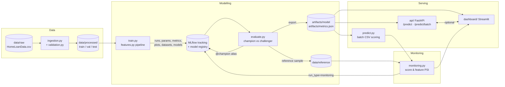

# Architecture

The platform covers the full lifecycle of a probability-of-default (PD) model:
**ingest → validate → engineer → train → evaluate → register → deploy → monitor**.
MLflow is the system of record for experiments and model versions.



## Components

| Path | Responsibility |
|---|---|
| `configs/model_config.yaml` | Single source of configuration: data paths and splits, excluded features, hyper-parameters, MLflow names, promotion rules, risk grades, decision cut-offs, strategy and monitoring thresholds |
| `src/credit_risk/__init__.py` | Config loading (`load_config`, `CREDIT_RISK_CONFIG`, `CREDIT_RISK_HOME`) |
| `src/credit_risk/ingestion.py` | Raw loading and type standardisation, stratified 64/16/20 splits cached as parquet, monitoring reference sample, synthetic data for tests and demo mode |
| `src/credit_risk/validation.py` | Schema, target, uniqueness and range checks. Errors block training, warnings are reported |
| `src/credit_risk/features.py` | `add_features` (row-wise domain features) and preprocessing (impute, one-hot, scale) |
| `src/credit_risk/train.py` | Model pipelines (logreg, hgb, xgboost, lightgbm), MLflow-tracked training, Optuna tuning (nested runs), MLflow helpers |
| `src/credit_risk/evaluate.py` | Credit metrics (AUC, Gini, KS, PR-AUC, Brier, deciles), champion/challenger validation, promotion, export |
| `src/credit_risk/predict.py` | Model resolution and loading, input alignment, PD → grade → decision, reason codes, batch CLI |
| `src/credit_risk/monitoring.py` | PSI for scores and features (numeric and categorical), drift report, MLflow logging |
| `api/` | FastAPI service. Pydantic validation in `schemas.py`; the model is loaded once at start-up |
| `dashboard/` | Streamlit multipage app. `app.py` is the home page and the shared cached loaders |
| `artifacts/` | The exported champion (MLflow pyfunc model directory) and its test performance pack |

## Design decisions

**One pipeline object from raw input to PD.** The logged model is a scikit-learn `Pipeline`:
`FunctionTransformer(add_features) → ColumnTransformer(impute/encode) → classifier`. The API, batch scoring,
dashboard and MLflow serving all call the same object, so there is no training/serving skew. The model's
input signature is the 119 raw application columns. Missing columns are added as null and imputed.

**Safe model serialisation.** Models are stored in the skops format rather than pickle. `train.py` passes an explicit
allow-list of types (numpy, scikit-learn, scipy, xgboost, lightgbm, this package). Anything unexpected makes
logging fail rather than being trusted silently.

**No real customer records in artifacts.** The model's `input_example` is a synthetic "median applicant", and the
loan-level data is git-ignored. Tests and CI use `synthetic_applications()`.

**Strict split discipline.** Features and hyper-parameters are selected on the validation split. The test split
is used only for reported metrics and the champion/challenger decision.

**Protected attributes.** `CODE_GENDER` is excluded from the model inputs (and ignored by the API if sent). It
stays in the data so fairness can be monitored; see `docs/model_card.md`.

**Registry aliases rather than stages.** `@champion` (production), `@challenger` (under validation) and
`@previous_champion` (rollback target). MLflow 3 deprecates stages.

**Exported champion for serving.** Promotion copies the champion into `artifacts/model`. The API and Docker
image therefore run without an MLflow server, and the deployed model is versioned in git alongside
`metrics.json`. `MODEL_URI=models:/credit-risk-pd@champion` serves straight from the registry instead.

---

## MLflow lifecycle

### Tracking server

```bash
uv run mlflow server --backend-store-uri sqlite:///mlflow.db --artifacts-destination ./mlartifacts --port 5000
# or: docker compose up mlflow
```

| Store | Location | Holds |
|---|---|---|
| Backend | `mlflow.db` (SQLite) | experiments, runs, params, metrics, tags, model registry |
| Artifacts | `mlartifacts/` | models, plots, tables, environment files (proxied through the server) |

Clients use `MLFLOW_TRACKING_URI` (default `http://127.0.0.1:5000`). For a team set-up, use a PostgreSQL backend and
object storage: `--backend-store-uri postgresql://… --artifacts-destination s3://bucket/mlflow`. No code changes are needed.

### Track

```bash
uv run python -m credit_risk.train --model lightgbm --sample 40000                 # quick experiment
uv run python -m credit_risk.train --model xgboost --param max_depth=6             # override a hyper-parameter
uv run python -m credit_risk.train --model lightgbm --tune --trials 30 --sample 60000
uv run python -m credit_risk.train --model lightgbm --register                     # full data, registered
```

Each run logs the following:

| What | Where in the UI |
|---|---|
| `model__*` hyper-parameters, row counts | Parameters |
| `val_*` and `test_*`: roc_auc, gini, ks, pr_auc, brier, log_loss, mean_predicted_pd, observed_default_rate; `val_test_psi`; `fit_seconds` | Metrics |
| train / val / test datasets (schema and digest) | Inputs |
| `data_fingerprint_train`, `model_family`, `excluded_features` | Tags |
| ROC, calibration and PD-distribution plots | Artifacts → `plots/` |
| decile/lift table, top-50 feature importance | Artifacts → `tables/` |
| full pipeline with signature, synthetic input example and bundled source code | Logged model |

Tuning creates a parent run `tune-<model>` with one nested run per trial and a final `best-<model>` run that holds the model.

### Evaluate and promote

```bash
uv run python -m credit_risk.evaluate                   # newest version vs @champion (read-only)
uv run python -m credit_risk.evaluate --version 3 --promote
uv run python -m credit_risk.evaluate --export          # re-export current @champion
```

1. Sets `@challenger` on the candidate and scores the test split with the challenger and the champion.
2. Logs a `validate-v<N>` run with both models' metrics, `delta_roc_auc`, the champion-vs-challenger score PSI,
   a calibration plot, a decile table, and MLflow's built-in classifier evaluation of the accept/decline decision.
3. Passes if the challenger beats the champion by `promotion.min_improvement` (AUC). It warns if score PSI exceeds `promotion.max_psi`.
4. Tags the version with `validation_status` and `test_roc_auc`.
5. `--promote` (only if the challenger passes) moves `@champion` and records `@previous_champion`. It then **exports**:
   `artifacts/model`, `artifacts/metrics.json` (metrics, ROC points, calibration bins, deciles) and
   `data/reference/reference_sample.parquet` (training applications plus champion PDs, used for monitoring).

Rollback: `MlflowClient().set_registered_model_alias("credit-risk-pd", "champion", "<previous version>")`, then `--export`.

### Deploy

| Mode | Command | Notes |
|---|---|---|
| REST API | `uv run uvicorn api.main:app --port 8000` | Docs at `/docs`. `/predict` returns PD, grade, decision and reason codes |
| Batch | `uv run python -m credit_risk.predict --input apps.csv` | Writes to `data/scored/` |
| MLflow serving | `uv run mlflow models serve -m artifacts/model -p 5001 --env-manager local` | Generic `/invocations` endpoint returning `[P(0), P(1)]` |
| Docker | `docker build -t credit-risk-platform . && docker run -p 8000:8000 credit-risk-platform` | API using the committed champion |
| Full stack | `docker compose up --build` | MLflow on :5000, API on :8000, dashboard on :8501 |

### Monitor

```bash
uv run python -m credit_risk.monitoring                          # test split vs reference
uv run python -m credit_risk.monitoring --current new_month.csv --log
```

Score PSI and per-feature PSI (numeric and categorical) are calculated against the champion's development
sample. Thresholds: < 0.10 stable, 0.10–0.25 warning, > 0.25 alert. Reports are written to `reports/` and,
with `--log`, to MLflow (`run_type=monitoring`). Dashboard page 5 shows the same numbers interactively,
including stress scenarios.

---

## Testing and CI

`tests/` runs entirely on synthetic data (36 tests, about 10 s). It covers ingestion and validation, feature
engineering (row-wise and leakage-safe), every algorithm's pipeline, the MLflow train → log → load → score
round trip on a temporary SQLite store, monitoring, and the API (validation, batch, reason codes, degraded mode).

`.github/workflows/ci.yml` runs on every push and pull request to `main`:

1. **Lint & test:** `uv sync --frozen`, `ruff check`, `pytest`, and a check that `requirements.txt` matches `uv.lock`.
2. **Docker:** builds the image, starts the API with the committed champion, and checks `/health` and `/predict`.

## Configuration and environment

| Variable | Default | Purpose |
|---|---|---|
| `MLFLOW_TRACKING_URI` | `http://127.0.0.1:5000` | Tracking server and registry |
| `MODEL_URI` | `artifacts/model` | Model for the API and dashboard (path or `models:/…`) |
| `API_URL` | unset | When set and healthy, the dashboard scores through the API |
| `CREDIT_RISK_CONFIG` | `configs/model_config.yaml` | Alternative config file |
| `CREDIT_RISK_HOME` | repository root | Project root, when installed outside the repo (Docker sets `/app`) |
| `MLFLOW_DISABLE_AGENT_HINT` | `1` in Docker | Silences MLflow's tracing-skill log hint |
