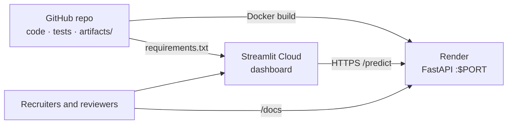

# Deployment: public demo

The public demo has two parts:

| Component | Host | What it serves | Live |
|---|---|---|---|
| Scoring API | [Render](https://render.com), free web service (Docker) | `api/` with the committed champion in `artifacts/model` | [credit-risk-api-pdf9.onrender.com](https://credit-risk-api-pdf9.onrender.com/docs) |
| Dashboard | [Streamlit Community Cloud](https://streamlit.io/cloud) | `dashboard/app.py`, scoring through the API | [rl-credit-risk-platform.streamlit.app](https://rl-credit-risk-platform.streamlit.app) |



**No loan-level data is deployed.** The Home Credit data can't be redistributed, so the dashboard runs in demo
mode: it scores a synthetic portfolio with the real champion model. The portfolio is drawn to match the real
test set's PD deciles (aggregates in `metrics.json`), with outcomes drawn from a "true" risk the model only partly captures. The model therefore
works well on it (AUC about 0.70) but below its real 0.769, as on any new population (`predict.simulated_portfolio`). It also shows the real test-set metrics from
`artifacts/metrics.json`. The MLflow server stays local. Screenshots of the experiment comparison go in the README.

Free tiers sleep when idle. The first request after a pause takes about a minute. Check the current limits and
pricing on each host before deploying. Keep screenshots and a short recording in the README in case a service is
asleep or down.

## 1. Before you deploy

```bash
uv run ruff check . && uv run pytest -q     # includes a demo-mode render test of every dashboard page
git push origin main                        # CI builds the Docker image and smoke-tests the API
```

Wait for the CI run to pass. Both hosts deploy from `main`.

## 2. API on Render

1. Sign in to Render with GitHub and give it access to the `credit-risk-ml-platform` repository.
2. **New → Blueprint**, pick the repository. Render reads [`render.yaml`](../render.yaml): a Docker web service
   called `credit-risk-api` on the free plan, with health check path `/health`.
3. Deploy. The Dockerfile starts uvicorn on the `PORT` variable that Render sets.
4. Copy the service URL shown under the service name. Render usually adds a suffix to the name
   (`credit-risk-api-xxxx.onrender.com`), so don't guess it. Check it:
   ```bash
   curl -s https://<your-service>.onrender.com/health        # {"status":"ok","model_loaded":true,...}
   curl -s -X POST https://<your-service>.onrender.com/predict -H 'Content-Type: application/json' \
        -d '{"AMT_INCOME_TOTAL": 180000, "AMT_CREDIT": 500000, "AMT_ANNUITY": 27000, "EXT_SOURCE_2": 0.6}'
   ```
   Swagger docs are at `/docs`.

The API has no authentication. It only serves the demo model, holds no data, and stores nothing it receives.

## 3. Dashboard on Streamlit Community Cloud

1. Sign in at share.streamlit.io with GitHub. **Create app → Deploy a public app from GitHub**.
2. Settings:

   | Setting | Value |
   |---|---|
   | Repository | `<your-github-user>/credit-risk-ml-platform` |
   | Branch | `main` |
   | Main file path | `dashboard/app.py` |
   | Python version (Advanced settings) | 3.13 |

   Dependencies come from the root `requirements.txt`. The dashboard adds `src/` to the import path itself, so
   the project package doesn't need installing.
3. **Advanced settings → Secrets**: paste (see [`.streamlit/secrets.toml.example`](../.streamlit/secrets.toml.example))
   ```toml
   API_URL = "https://<your-service>.onrender.com"
   ```
   Without it the dashboard scores in-process with the bundled model, which also works.
4. Deploy, open the app, and check the sidebar: **Scoring via: API** means the dashboard is reaching Render.
   The dashboard waits only 5 seconds for the API's health check. If the API was asleep the sidebar shows
   **in-process model**: open the API's `/health` once, wait for it to answer, then refresh the dashboard.
   Secrets can be changed later under the app's **⋮ → Settings → Secrets**; saving restarts the app.

## 4. Update the README

Add the live links (dashboard, API `/docs`), screenshots of each dashboard page and of the MLflow experiment
comparison, and the demo video link.

## Updating the deployed model

Promotion (`credit_risk.evaluate --promote`, see [architecture](architecture.md#evaluate-and-promote)) re-exports
`artifacts/`. Commit and push it. CI rebuilds the image, Render redeploys the API, and Streamlit Cloud reloads the
dashboard.

## Local equivalents

| | Command |
|---|---|
| API only | `docker build -t credit-risk-platform . && docker run -p 8000:8000 credit-risk-platform` |
| API on another port, like Render | `docker run -e PORT=10000 -p 10000:10000 credit-risk-platform` |
| Full stack (MLflow, API, dashboard) | `docker compose up --build` |
